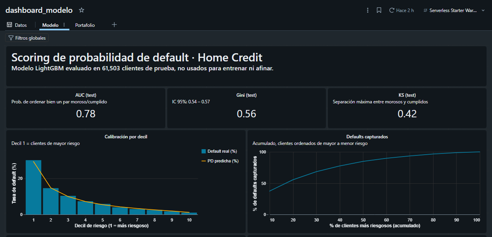
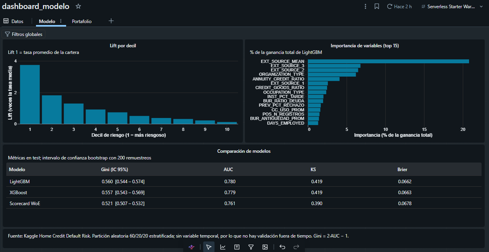
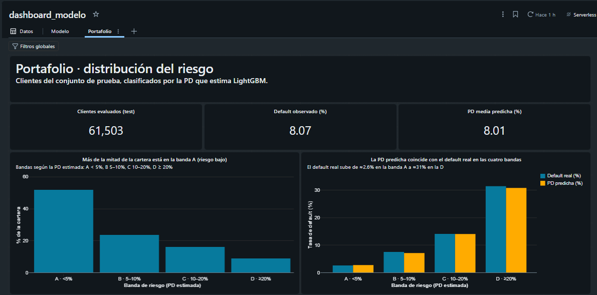
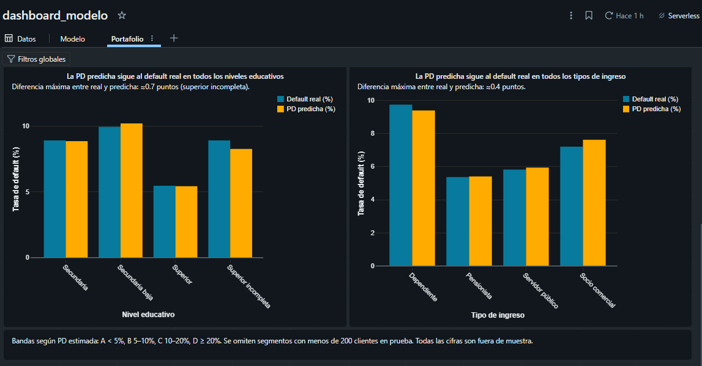
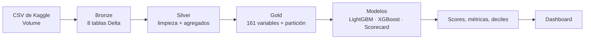

# Scoring de probabilidad de default (PD) en Databricks · Home Credit

> **TL;DR (EN):** End-to-end credit-risk project on Databricks Free Edition: medallion pipeline (Delta Lake) over 7 relational tables, three PD models (LightGBM, XGBoost, WoE scorecard) tracked with MLflow, and an AI/BI dashboard. LightGBM reaches a Gini of 0.56 (95% CI 0.54–0.57) on a held-out test set of 61,503 clients.

## Resumen

Modelo de probabilidad de incumplimiento (PD) sobre el dataset público [Home Credit Default Risk](https://www.kaggle.com/c/home-credit-default-risk) de Kaggle. El proyecto cubre el ciclo completo: ingesta, arquitectura medallion (bronze / silver / gold), ingeniería de variables a partir de varias tablas relacionales, tres modelos comparados, evaluación fuera de muestra, seguimiento de experimentos con MLflow y un dashboard.

**Desempeño del modelo (LightGBM, conjunto de prueba):** métricas principales, calibración por decil y defaults capturados.

**Lift, variables más influyentes y comparación de modelos.**

## Resultados (conjunto de prueba, 61,503 clientes)

| Modelo | Gini (IC 95%) | AUC | KS | Brier |
|---|---|---|---|---|
| LightGBM | 0.560 [0.544 – 0.574] | 0.780 | 0.419 | 0.0662 |
| XGBoost | 0.557 [0.543 – 0.569] | 0.779 | 0.419 | 0.0663 |
| Scorecard WoE + regresión logística | 0.521 [0.507 – 0.532] | 0.761 | 0.390 | 0.0678 |

**Portafolio:** distribución del riesgo por banda y por segmento.

- **Discriminación:** el 10% de clientes de mayor riesgo concentra el 37.4% de los defaults y el 20% concentra el 55.5%. La tasa de default real va del 30.2% en el decil más riesgoso al 1.0% en el menos riesgoso.
- **Calibración:** la PD predicha coincide con la tasa real en todos los deciles (diferencias de medio punto porcentual o menos, salvo el decil 1, subestimado en unos 0.8 puntos). No se balancearon las clases, por eso las probabilidades se mantienen interpretables.
- **Boosting vs. scorecard:** los intervalos no se solapan; el costo de usar un modelo interpretable es de unos 0.04 de Gini. Entre LightGBM y XGBoost no hay diferencia distinguible.
- **Importancia de variables:** los puntajes externos (`EXT_SOURCE_*`) suman cerca del 37% de la ganancia. Cuatro de las diez variables principales se construyeron en este proyecto (`ANNUITY_CREDIT_RATIO`, `CREDIT_GOODS_RATIO`, `INST_PCT_TARDE`, `BUR_RATIO_DEUDA`).
- **Consistencia por segmento:** la PD media predicha (8.01%) es casi igual al default observado (8.07%), y la PD sigue al default real en cada banda de riesgo y en los segmentos por nivel educativo y tipo de ingreso, con diferencias menores a un punto porcentual.

## Datos

`application_train` (307,511 solicitudes, 8.07% de default) más seis tablas secundarias: `bureau` (1.7 M), `bureau_balance` (27.3 M), `previous_application` (1.7 M), `installments_payments` (13.6 M), `credit_card_balance` (3.8 M) y `POS_CASH_balance` (10.0 M filas). `application_test` se carga pero no se usa, porque no incluye la variable objetivo. Los datos **no se incluyen** en este repositorio (condiciones de Kaggle).

## Pipeline

| Notebook | Contenido |
|---|---|
| `01_bronze` | Carga de los CSV a tablas Delta, con verificación de conteos |
| `02_eda` | Análisis exploratorio y decisiones de limpieza |
| `03_silver` | Limpieza y agregados por cliente de las seis tablas secundarias |
| `04_gold` | Unión, ratios de capacidad de pago y partición 60/20/20 |
| `05_modelos` | Modelos, evaluación, tablas de métricas y MLflow |

## Metodología

- **Partición** 60/20/20 estratificada por la variable objetivo, reproducible mediante hash del identificador del cliente. Los tres conjuntos conservan el 8.07% de default.
- **Sin fuga de información:** las transformaciones aprendidas (tramos y pesos WoE) se calculan solo con el conjunto de entrenamiento; `valid` se usa para detener el entrenamiento de los árboles; `test` se evaluó una sola vez, al final.
- **Limpieza:** el valor centinela `DAYS_EMPLOYED = 365243` (jubilados) se convierte a nulo; las razones usan división segura; los nulos de las variables de vivienda se conservan por ser informativos (tasa de default de 8.6% frente a 6.9%).
- **Scorecard:** WoE por tramos de cuantiles (los nulos forman un tramo propio), selección por IV entre 0.02 y 0.5, descarte de variables con correlación mayor a 0.7 y eliminación iterativa de variables con coeficiente de signo contrario al riesgo. Resultado: 33 variables. Se probó incluir `EXT_SOURCE_MEAN` (IV 0.59) y no mejoró el modelo.
- **Incertidumbre:** intervalos de confianza del Gini por bootstrap (200 remuestreos).
- **Seguimiento:** todos los experimentos quedan registrados en MLflow.

## Limitaciones

- El dataset no tiene fechas, así que la partición es aleatoria y **no hay validación fuera de tiempo**. Por la misma razón se omitió el PSI (con partición aleatoria vale cerca de cero por construcción).
- La variable objetivo solo se observa en créditos desembolsados; no se aborda la inferencia de solicitudes rechazadas.
- El modelo depende mucho de puntajes externos anónimos (`EXT_SOURCE_*`). La importancia por ganancia describe el uso del modelo, no causalidad.
- Se incluyeron variables demográficas (género, edad) por tratarse de un ejercicio académico. En un entorno real requerirían revisión regulatoria y de equidad.
- Proyecto educativo sobre Databricks Free Edition (uso no comercial).

## Cómo reproducirlo

1. Acepta las reglas de la competencia y descarga los datos desde Kaggle.
2. En Databricks Free Edition, crea el volumen `workspace.credit_risk.raw` y sube los CSV (lo hace `01_bronze`).
3. Ejecuta los notebooks en orden, del `01` al `05`.

---
**Autor:** César Fabrizio Salas Molina · [LinkedIn](https://www.linkedin.com/in/fabrizio-salas-molina-84565b401) · [fabriziosalasmolina@gmail.com](mailto:fabriziosalasmolina@gmail.com)
